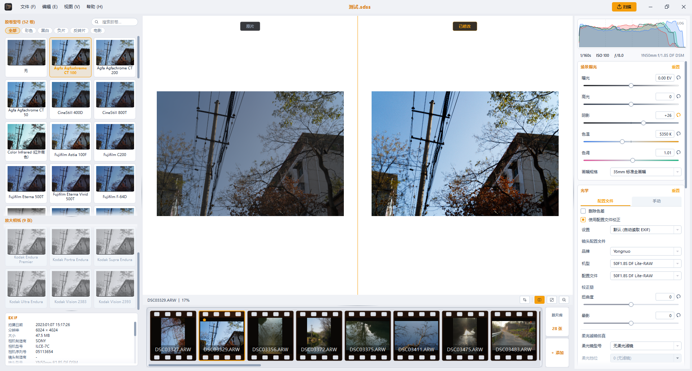

<div align="center">

# 🎞️ SpektraDarkroom Vulkan Edition

### 专业级 35mm 胶片物理显影与放大暗房模拟工作站 (Windows)

[](LICENSE)
[](https://creativecommons.org/licenses/by-sa/4.0/)
[-0078D6.svg?logo=windows)](https://www.microsoft.com)
[](https://www.python.org)
[](https://www.vulkan.org)

<br/>



</div>

---

## 📖 项目简介

**SpektraDarkroom** 是一款面向 Windows 平台的专业级 35mm 胶片物理显影与放大暗房模拟工作站。软件基于连续光谱模拟与光化学感光/显影模型，完整还原相机 RAW 负片曝光、DIR 发色剂层内/层间抑制扩散、彩色放大机减色法滤色曝光、相纸光化学显影及真实银盐染料云团微粒质感。

---

## ✨ 核心特性

### 1. 物理暗房连续光谱仿真
- **81 波段物理光谱测定**：基于真实感光度与吸收率计算，彻底告别普通 3D LUT 的断阶与偏色。
- **52 款胶卷预设 + 9 款相纸/拷贝片档案**：
  - **经典彩色负片**：Kodak Portra 160 / 400 / 800，Gold 200，ColorPlus 200，UltraMax 400，Ektar 100；Fujifilm Pro 400H / 160NS，C200，Superia X-TRA 400 等；
  - **电影工业底片**：Kodak Vision3 50D / 200T / 250D / 500T，CineStill 50D / 400D / 800T，Fujifilm Eterna 500T / Vivid 500T，F-64D 等；
  - **传奇反转片**：Fujifilm Velvia 50 / 100，Provia 100F，Astia 100F，Kodak Ektachrome E100，Kodachrome 25 / 64 / 200，Agfachrome CT 50 / 100 / 200 等；
  - **经典黑白负片**：Kodak Tri-X 400，T-Max 100，Ilford HP5 Plus 400，FP4 Plus 125，Delta 3200，Fujifilm Neopan Acros 100，Kodak Double-X 5222 等；
  - **彩色相纸与放映拷贝片**：Kodak Vision 2383 / 2393 电影拷贝片，Kodak Endura Premier，Portra Endura，Ultra Endura，Supra Endura，Ektacolor Edge，Fujifilm Crystal Archive II 水晶相纸，以及数码扫描反演模式。
- **减色法放大机滤色头 (Dichroic Filter Pack)**：精确模拟 Cyan、Magenta、Yellow 连续无极滤光片微调，内置全套组合的中性灰平衡（Neutral Print Filters Table）自动校准。
- **真实胶片微粒与染料云团 (CLT Dye Clouds)**：基于中心极限定理（CLT）视口积分衰减模型，模拟真实 35mm C-41 染料云团与 RGB 乳剂层厚度解耦采样，适应全图柔和细腻，1:1 放大微晶锐利咬合。
- **显影物理光学质感**：非线性物理边界红光晕反射弥散（Halation）、显影抑制剂层内/层间扩散（DIR Couplers）、暗房预闪光（Pre-flash）以及画幅微粒比例缩放。

### 2. 毫秒级视口与 GPU 硬件加速管线
- **Modern OpenGL / Vulkan 硬件加速**：着色器级 3D 物理色彩空间映射，支持 4K 高分辨率实时视口渲染与 60+ FPS 交互。
- **平滑变焦与锚点对齐**：支持 10% 至 800% 无级缩放，双击放大时以光标物理落点为对准锚点，支持 1:1 像素与全貌适应快捷切换。
- **对比与检查工具**：支持双视口可拖拽分割线对比，以及长按快捷键（`\`）瞬间原片对比。
- **多档导出管线**：提供全 CPU 精确离屏渲染与离屏帧缓冲 GPU 硬件加速并行导出。

### 3. 专业批量暗房生产力
- **原生 RAW 支持**：支持 ARW、CR2、CR3、NEF、RAF、DNG、32位浮点/16位无损 TIFF 与 PNG。
- **非破坏性编辑伴侣文件 (.sdc)**：调色与冲印参数自动写入同目录下 `.sdc` 伴侣文件，原始素材文件绝对只读，支持随时一键还原。
- **底片工程会话管理 (.sdss)**：支持将当前暗房工作区完整保存为工程文件，支持跨设备与二次恢复编辑。
- **底片栏多选与批量批处理**：支持 Ctrl+Click、Shift+Click 区间连选及全选，支持整套暗房参数跨照片复制粘贴与批量多线程流水线导出。
- **内存保护与两级缓存体系**：内置 Tier 1 微缩图与 Tier 2 视口纹理高速缓存，搭配严密的 LRU 内存回收控制，多底片大图连续切换内存平稳可控。
- **平滑微调滑块**：横向拖拽数值标签即可微步步进，支持键盘微调与完整的撤销/重做（Ctrl+Z / Ctrl+Y）历史栈。

---

## 🖥️ 运行环境要求

* **操作系统**：Windows 10 / Windows 11 (64-bit)
* **Python 版本**：Python 3.10 - 3.13 (64-bit)
* **图形硬件**：支持 OpenGL 3.3+ 及 Vulkan 兼容驱动的显卡（NVIDIA / AMD / Intel 独立显卡或集成显卡均可）

---

## 📦 快速开始与源码运行

### 1. 克隆代码仓库
```bash
git clone https://github.com/wwppp/spektra-darkroom.git
cd spektra-darkroom
```

### 2. 创建并激活 Python 虚拟环境 (推荐)
```bash
python -m venv .venv

# Windows PowerShell
.\.venv\Scripts\Activate.ps1

# 或 Windows Command Prompt (cmd)
.\.venv\Scripts\activate.bat
```

### 3. 安装依赖
物理仿真引擎及关键核心均已内置，直接安装依赖清单：
```bash
pip install -r requirements.txt
```

### 4. 启动应用
- **双击启动器**（推荐，无黑框）：直接双击根目录下的 **`SpektraDarkroom.exe`**；
- **或通过命令行启动**：
  ```bash
  python main.py
  ```

---

## ⚖️ 开源许可协议 (Licenses)

本项目采用规范的开源许可策略：

1. **软件源代码部分**：遵循 **[GNU General Public License v3.0 (GPLv3)](LICENSE)** 协议开源。
2. **物理胶卷与相纸测定配置文件 (`resources/profiles/`)**：基于光谱测定与公开技术参数数字化整理，遵循 **[CC BY-SA 4.0](https://creativecommons.org/licenses/by-sa/4.0/)**。
3. **衍生 3D LUT 数据集**：遵循商业可用、自由共享、严禁拆分单独倒卖转售协议。

---

## 🙏 致谢与开源项目致敬 (Credits & Acknowledgments)

- **[Andrea Volpato (spektrafilm)](https://github.com/andreavolpato/spektrafilm)**：衷心感谢 Andrea Volpato 发起的开源项目 `spektrafilm`。其在连续光谱感光乳剂模型、发色剂化学显影反应及中性灰平衡矩阵上的严谨色彩科学研究，为本项目奠定了坚实的光谱算法基石。
- **[fotufilm-engine](https://github.com/fotufilm/fotufilm-engine)**：衷心感谢 `fotufilm-engine` 项目。本项目深入研究并吸纳了其多层彩色染料云团（Dye Clouds）胶片微粒模型、乳剂层微观物理参数设计，以及多款高精度经典胶卷光谱配置与扩展数据，使 SpektraDarkroom 的微观微粒质感和胶片库生态得到了质的飞跃。
- **[James Qiu (SpektraLab)](https://github.com/JamesQiu2005/SpektraLab)**：感谢其在暗房原生化与工程化实践中提供的有益思路。
- **[pixls.us 自由开源摄影社区](https://discuss.pixls.us)**：感谢开源摄影社区在数据手册数字化、色彩测定和物理暗房模型测试中给予的无私讨论与支持。
