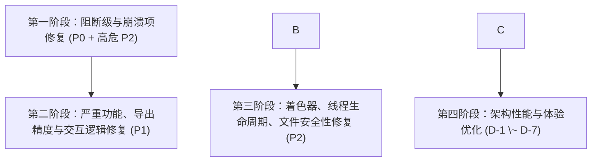

# SpektraDarkroom 缺陷分析与修复计划

本文档基于第三方测试报告《SpektraDarkroom 深度缺陷测试报告》对项目当前代码库进行逐项核验、技术评估与分类规划。

\---

## 目录

1. [执行摘要与评估概览](#一执行摘要与评估概览)
2. [阻断级缺陷分析（P0）](#二阻断级缺陷分析p0)
3. [严重缺陷分析（P1）](#三严重缺陷分析p1)
4. [中等缺陷分析（P2）](#四中等缺陷分析p2)
5. [低优先级与设计优化建议（D）](#五低优先级与设计优化建议d)
6. [分阶段修复实施计划](#六分阶段修复实施计划)

\---

## 一、执行摘要与评估概览

### 1.1 背景说明

第三方测试工具针对较早送测版本进行了自动化与手工回归测试，共提交 34 项记录（4 个 P0 阻断、9 个 P1 严重、13 个 P2 中等、8 个设计建议）。
根据用户要求：

1. **P1-1（导出覆盖原图风险）**：此行为属于用户刻意保留的工作流设计，本次评估判定为**保留现状（忽略修改）**，但在报告中记录其机制与行为边界。
2. 对其余全部缺陷进行代码层级核查，评估在当前版本下的真实存在性、触发条件、影响范围及修改必要性。

### 1.2 缺陷状态统计总表

|级别|总数|需立即修复|建议优化/排期|保持现状/不修改|核心影响摘要|
|-|-|-|-|-|-|
|**P0 阻断级**|4|4|0|0|缺失依赖无法启动、LUT文件被gitignore误杀、删除照片必崩、缓存恢复必崩|
|**P1 严重级**|9|8|0|1|32位导出精度虚高、1:1缩放失真、Shift多选失效、双击裁剪破坏栈、扫描模式被覆盖、无sdc导出色彩偏差、导出同名覆盖、扩展名与编码不一致；(P1-1依用户指令保持现状)|
|**P2 中等级**|13|11|2|0|翻转着色器偏导笔误、双击重置冗余渲染、中键裁剪平移、非原子写入SDC、取消导出删文件、退出线程悬挂、直方图按键误触、CR3元数据、3处未定义变量、浮点字号告警等|
|**设计建议**|8|0|6|2|缓存LRU按时间戳倒挂、LUT字典无上限、并发卡片线程无上限、会话sdss缺少配方、撤销栈跨照片隔离等|
|**合计**|**34**|**23**|**8**|**3**|-|

\---

## 二、阻断级缺陷分析（P0）

### P0-1 requirements.txt 漏掉必需依赖与未使用的调试引入

* **现象描述**：在全新干净 Python 环境下根据 `requirements.txt` 安装依赖后启动报错 `ModuleNotFoundError`。漏掉了 `numba`、`opt\_einsum`、`scikit-image`；且 `spektrafilm/model/color\_filters.py` 顶层直接导入了 `matplotlib.pyplot`。
* **当前代码定位**：

  * [requirements.txt](file:///d:/spektra-darkroom-Vulkan/requirements.txt)：未包含 `numba`、`opt\_einsum`、`scikit-image`。
  * [color\_filters.py](file:///d:/spektra-darkroom-Vulkan/spektrafilm/model/color_filters.py#L9)：第 9 行顶层执行 `import matplotlib.pyplot as plt`，但实际仅用于底部测试绘图脚本。
* **评估结论**：**需立即修改**。
* **技术处置**：

  1. 在 [requirements.txt](file:///d:/spektra-darkroom-Vulkan/requirements.txt) 中补充 `numba>=0.59.0`、`opt\_einsum>=3.3.0`、`scikit-image>=0.22.0`。
  2. 将 [color\_filters.py](file:///d:/spektra-darkroom-Vulkan/spektrafilm/model/color_filters.py) 顶层的 `import matplotlib.pyplot as plt` 移入 `if \_\_name\_\_ == '\_\_main\_\_':` 代码块内，避免非开发运行期强制依赖庞大的 matplotlib 库。

### P0-2 仓库核心数据文件 irradiance\_xy\_tc.npy 被 .gitignore 规则屏蔽

* **现象描述**：胶片引擎运行所需的关键色温查找表数据文件 `spektrafilm/data/irradiance\_xy\_tc.npy`（约 5.7MB）因 `.gitignore` 中的 `\*.npy` 规则被排除出 Git 追踪，导致克隆或解压工程后缺失文件，启动即抛 `FileNotFoundError`。
* **当前代码定位**：

  * [.gitignore](file:///d:/spektra-darkroom-Vulkan/.gitignore#L59)：第 59 行存在 `\*.npy` 通配规则。
  * 本地虽然存在该文件，但未纳入版本控制，任何协同开发或打包环境都会复现缺失。
* **评估结论**：**需立即修改**。
* **技术处置**：

  1. 在 [.gitignore](file:///d:/spektra-darkroom-Vulkan/.gitignore) 中添加白名单例外：`!spektrafilm/data/irradiance\_xy\_tc.npy`。
  2. 强制将该文件通过 `git add -f` 纳入仓库追踪。
  3. 在引擎读取处增加文件存在性校验，若意外缺失则提示友好引导，避免静默崩溃。

### P0-3 on\_delete\_multiple\_photos 必然抛 NameError

* **现象描述**：在胶片条多选照片并右键删除，或按 Delete 键批量删除时，在文件成功移入回收站后直接抛出 `NameError: name 'count' is not defined` 导致应用崩溃。
* **当前代码定位**：

  * [main\_window.py](file:///d:/spektra-darkroom-Vulkan/ui/main_window.py#L8649)：`logger.info(f"Successfully deleted {count} photo files.")`，此处变量名实际为 `deleted\_count` 或 `len(target\_photos)`，不存在名为 `count` 的局部变量。
* **评估结论**：**需立即修改**。
* **技术处置**：
将 [main\_window.py](file:///d:/spektra-darkroom-Vulkan/ui/main_window.py#L8649) 处的 `count` 修正为实际计数值 `deleted\_count`。

### P0-4 从缓存恢复照片时 SpektraEngine 未导入抛 NameError

* **现象描述**：从本地会话缓存快速恢复底片元数据与预览图时，如果缓存缺少自动曝光值，触发回退重新计算时抛出 `NameError: name 'SpektraEngine' is not defined` 导致渲染管线中断。
* **当前代码定位**：

  * [main\_window.py](file:///d:/spektra-darkroom-Vulkan/ui/main_window.py#L8145)：直接调用 `SpektraEngine.calculate\_auto\_exposure\_ev(...)`，但 [main\_window.py](file:///d:/spektra-darkroom-Vulkan/ui/main_window.py) 顶层并未导入 `SpektraEngine`（仅导入了模块中的其他工具）。
* **评估结论**：**需立即修改**。
* **技术处置**：
在 [main\_window.py](file:///d:/spektra-darkroom-Vulkan/ui/main_window.py) 导入区增加 `from core.app\_core import SpektraEngine`，或直接通过实例属性 `self.engine.calculate\_auto\_exposure\_ev(...)` 进行调用。

\---

## 三、严重缺陷分析（P1）

### P1-1 导出默认路径为原始素材本身，存在覆盖风险

* **现象描述**：测试报告指出，导出对话框的默认路径直指源照片路径，若用户未修改文件名直接点导出，会覆写原始素材。
* **用户指令与设计说明**：**用户明确声明「其中我看到有覆盖jpg图像的风险，此为我刻意为之可以忽略」**。
* **评估结论**：**保持现状（不修改）**。

  * 这是用户的明确设计偏好（允许无缝原位覆盖 JPG 缩略/预览图），尊重用户业务预期，不强行注入后缀。

### P1-2 32 位浮点 TIFF 导出实际仅有 16 位整数精度

* **现象描述**：用户选择导出 32-bit Float TIFF 时，生成的 TIFF 文件结构虽声明为 `float32`，但其实际像素值均为 `k / 65535` 的离散阶梯，并非真正的单精度浮点色深。
* **当前代码定位**：

  * [canvas\_viewport.py](file:///d:/spektra-darkroom-Vulkan/ui/canvas_viewport.py#L2324)：在离屏渲染读取 FBO 像素时，代码无条件调用了：
`glReadPixels(0, 0, w, h, GL\_RGBA, GL\_UNSIGNED\_SHORT, ...)`
返回的数据被硬转为 uint16，随后在保存逻辑中除以 65535 转成 float32 写入 TIFF，导致有效动态范围被截断在 16 位以内。
* **评估结论**：**需立即修改**。
* **技术处置**：
在 [canvas\_viewport.py](file:///d:/spektra-darkroom-Vulkan/ui/canvas_viewport.py) 的 `read\_fbo\_pixels` 中根据请求的导出格式与位深进行分支判断：对于 32 位浮点导出，使用 `GL\_RGBA` + `GL\_FLOAT` 直接读取 FBO 的 32 位浮点纹理数据；对于 16 位 TIFF 使用 `GL\_UNSIGNED\_SHORT`；对于 8 位使用 `GL\_UNSIGNED\_BYTE`。

### P1-3 1:1 实际像素缩放对小图强制放大到 200%

* **现象描述**：对于分辨率小于视口的图片（例如 800x500 的图片），按下 `Ctrl+1` 或点击「1:1 实际像素」，视口强制放大至 194%\~200%，状态栏显示放大比率异常，画面出现插值模糊。
* **当前代码定位**：

  * [canvas\_viewport.py](file:///d:/spektra-darkroom-Vulkan/ui/canvas_viewport.py#L1780)：
`if target\_zoom < 1.25: target\_zoom = max(2.0, target\_zoom)`
此处硬编码了人为保底放大逻辑，违背了 1:1 像素映射（1 屏幕像素 = 1 图像像素）的直觉。
* **评估结论**：**需立即修改**。
* **技术处置**：
移除该强制保底条件，在 `set\_zoom\_100()` 中将缩放比例严格锁定为 `1.0`（即 100% 实际物理像素）。

### P1-4 底片条 Shift+Click 范围选择锚点被覆盖，区间无法收缩

* **现象描述**：在底片条中点击第 1 张，Shift 点击第 5 张（选中 1\~5），若此时 Shift 点击第 3 张，预期应收缩为选中 1\~3，但实际变成了选中 3\~5。区间选择锚点（Anchor）每次都被当前激活照片覆盖。
* **当前代码定位**：

  * [filmstrip\_widget.py](file:///d:/spektra-darkroom-Vulkan/ui/filmstrip_widget.py#L1342)：底片条未区分 `\_selection\_anchor\_id` 与 `\_active\_id`，每次单选或点击都把 `\_active\_id` 当作新的范围基准点。
* **评估结论**：**需立即修改**。
* **技术处置**：
在 [filmstrip\_widget.py](file:///d:/spektra-darkroom-Vulkan/ui/filmstrip_widget.py) 中引入独立的 `\_selection\_anchor\_id`：

  * 只有在普通的无修饰单击（Single Click）时更新 `\_selection\_anchor\_id = photo\_id`。
  * 在 `Shift + Click` 时，仅更新选中集合与 `\_active\_id`，不改变 `\_selection\_anchor\_id`，从而保证区间可以自由拉伸与收缩。

### P1-5 裁剪框内双击立即提交并清空裁剪撤销栈

* **现象描述**：用户进入裁剪模式调整构图时，若在裁剪框内双击，会直接自动应用当前裁剪并退出模式，且该操作会清空裁剪内部撤销历史，导致用户误触后无法撤销微调。
* **当前代码定位**：

  * [crop\_overlay.py](file:///d:/spektra-darkroom-Vulkan/ui/crop_overlay.py#L1613)：`mouseDoubleClickEvent` 中直接调用了 `self.apply\_crop()`。
* **评估结论**：**需立即修改**。
* **技术处置**：

  1. 移除裁剪框内双击的 `apply\_crop()` 快捷绑定，避免误触。保留明确的「应用」按钮和 Enter 键确认。
  2. 修复 `apply\_crop()` 内部重置裁剪撤销栈的代码，使裁剪动作作为单一可撤销节点并入主窗口撤销栈，允许 `Ctrl+Z` 完整回退。

### P1-6 .sdc 的 print\_mode 多路径保存不一致，扫描模式被改回光学放印

* **现象描述**：用户在「数码扫描（scan）」模式下编辑底片，但通过多选批量保存或某些调用点触发保存时，模式被无条件重置为默认值 `optical`。
* **当前代码定位**：

  * [sdc\_manager.py](file:///d:/spektra-darkroom-Vulkan/core/sdc_manager.py#L80)：函数签名定义为 `def save\_sdc(..., print\_mode: str = "optical")`。
  * 在 [main\_window.py](file:///d:/spektra-darkroom-Vulkan/ui/main_window.py) 多处调用（如关闭窗口、批量同步等）未显式传参 `print\_mode`，直接触发了默认值 `"optical"`，导致用户的 `"scan"` 模式被静默覆盖。
* **评估结论**：**需立即修改**。
* **技术处置**：

  1. 将 [sdc\_manager.py](file:///d:/spektra-darkroom-Vulkan/core/sdc_manager.py) 中 `save\_sdc` 的默认参数改为 `print\_mode: str = None`。若为 None 则优先保留已有 SDC 中的模式，若新文件则默认 `"optical"`。
  2. 检查 [main\_window.py](file:///d:/spektra-darkroom-Vulkan/ui/main_window.py) 中所有调用点，一律显式传入 `self.current\_print\_mode` 或相片的实际 `print\_mode`。

### P1-7 批量/快速导出原生底片默认套用 Portra 400 + 2383

* **现象描述**：对于未曾手动调整、缺少 `.sdc` 伴侣文件的原生底片，批量导出或快速导出默认套用了 `Kodak Portra 400` + `2383` 胶片预设，导致导出成片色彩与画布上的原生预览完全不一致。
* **当前代码定位**：

  * [main\_window.py](file:///d:/spektra-darkroom-Vulkan/ui/main_window.py#L9277)：导出任务构建时，若相片未加载参数，硬编码回退到了 `"Kodak Portra 400"` 和 `"Kodak 2383"`。
* **评估结论**：**需立即修改**。
* **技术处置**：
对无 `.sdc` 的原生相片，回退策略应与当前主工作流保持一致：胶片类型为 `"none"`（直出/数码旁路模式），相纸为 `"scan"`，确保导出成片与未调色预览所见即所得。

### P1-8 导出文件名仅按 basename 生成，同名文件静默覆盖

* **现象描述**：在多选批量导出或多目录素材导入时，若不同子目录存在同名文件（如 `\_DSC0001.JPG`、`IMG\_0001.CR3`），导出队列按相同文件名写入同一个目标目录，后者会静默覆盖前者，且不给任何提示。
* **当前代码定位**：

  * [main\_window.py](file:///d:/spektra-darkroom-Vulkan/ui/main_window.py#L9334)：导出任务直接使用 `os.path.basename(p\["path"])`，未在目标路径发生重名冲突时进行数字自增（如 `\_1.jpg`、`\_2.jpg`）。
* **评估结论**：**需立即修改**。
* **技术处置**：
在导出任务分配路径前，增加重名探测与自动消歧逻辑：若目标文件已存在或已被本批次前面的任务占用，自动递增后缀（如 `filename\_1.jpg`）。

### P1-9 单张导出扩展名与实际编码格式不一致

* **现象描述**：用户在单张导出对话框中手动将文件扩展名修改为 `.png`，但在格式下拉框中保持 `JPEG`；或者在下拉框切换了格式但路径编辑框中的扩展名未联动更新，最终导出的文件出现「扩展名为 png 但内部数据实际是 jpeg」的混乱情况。
* **当前代码定位**：

  * [export\_dialog.py](file:///d:/spektra-darkroom-Vulkan/ui/export_dialog.py#L657)：路径变更和格式下拉框未做双向严格强校验与后缀强制补全。
* **评估结论**：**需立即修改**。
* **技术处置**：
在单张导出对话框点击「导出」确认时，强制校验当前所选格式所允许的扩展名；若后缀不匹配或缺少扩展名，依据选定的格式自动修正后缀（例如选 JPEG 则强行替换为 `.jpg`）。

\---

## 四、中等缺陷分析（P2）

### P2-1 着色器垂直翻转分支偏导计算笔误

* **现象描述**：在视口着色器启用垂直翻转渲染时，纹理梯度与颗粒足迹（footprint）偏导出现计算错误，导致 100% 视图下摩尔纹异常、颗粒密度垂直不对称。
* **当前代码定位**：

  * [canvas\_viewport.py](file:///d:/spektra-darkroom-Vulkan/ui/canvas_viewport.py#L327) 与第 379 行：
代码写成了 `d\_sample\_dx.y = -d\_sample\_dy.y;`，显而易见是复制粘贴时的手误，正确逻辑应为 `d\_sample\_dx.y = -d\_sample\_dx.y;`。
* **评估结论**：**需立即修改**。
* **技术处置**：
修正两处着色器源码中的偏导分量，将 `-d\_sample\_dy.y` 改为 `-d\_sample\_dx.y`。

### P2-2 会话缓存目录写探针多线程竞态与异常降级

* **现象描述**：`get\_cache\_dir()` 每次被调用都创建并删除 `.perm\_test` 探测可写性。多线程并发读取缓存时，前一个线程删除了探针文件，导致后一个线程 `os.remove` 失败抛异常，进而错误降级到系统的 `%LOCALAPPDATA%`，导致缓存碎片化和分裂。
* **当前代码定位**：

  * [session\_cache\_manager.py](file:///d:/spektra-darkroom-Vulkan/core/session_cache_manager.py#L61)：无任何内存缓存或锁保护，频繁进行磁盘 I/O 探测。
* **评估结论**：**需立即修改**。
* **技术处置**：
对探测结果使用模块级变量进行单次缓存（Memoization），仅在首次初始化时探测一次；后续直接返回已验证的缓存路径，彻底消除并发竞态。

### P2-3 ParamScrubSlider.reset() 双重发射信号

* **现象描述**：双击参数滑块标题执行「重置」时，`reset()` 中 `setValue()` 已自动发射 `valueChanged`，但后续代码又显式发射了一次 `valueChanged` 和 `sliderReleased`。
* **当前代码定位**：

  * [adobe\_scrub\_slider.py](file:///d:/spektra-darkroom-Vulkan/ui/adobe_scrub_slider.py#L634)：下游监听者收到 2 次信号，导致重渲染两次，并在撤销历史中产生冗余步骤。
* **评估结论**：**需立即修改**。
* **技术处置**：
清理 [adobe\_scrub\_slider.py](file:///d:/spektra-darkroom-Vulkan/ui/adobe_scrub_slider.py) 中冗余的手工 emit 调用，保留 `setValue()` 触发的标准信号流。

### P2-4 画布平移 pan\_x/pan\_y 缺乏边界约束保护

* **现象描述**：高倍率缩放下快速甩动画布，平移坐标无任何 Clamp 限制，图片容易被完全移出可视区域只剩空白背景，用户必须依赖快捷键重置。
* **当前代码定位**：

  * [canvas\_viewport.py](file:///d:/spektra-darkroom-Vulkan/ui/canvas_viewport.py#L2001)：平移累加未设置视口宽高维度的最大边界截断。
* **评估结论**：**需立即修改**。
* **技术处置**：
在更新 `pan\_x` 和 `pan\_y` 时加入软边界或硬边界 clamp 计算，保证图像在视口内至少始终保留一定可见比例（如 20%）。

### P2-5 参数复制粘贴浅拷贝共享 crop 字典对象

* **现象描述**：在主窗口执行「复制参数」并粘贴给多张照片后，在照片 B 上修改裁剪，会导致照片 C/D 的裁剪也一并被篡改。
* **当前代码定位**：

  * [main\_window.py](file:///d:/spektra-darkroom-Vulkan/ui/main_window.py#L5534) 与第 5588 行：参数字典使用了 `dict(self.current\_params)` 浅拷贝，而 `params\["crop"]` 是嵌套字典，多个相片引用了同一内存地址。
* **评估结论**：**需立即修改**。
* **技术处置**：
引入 `copy.deepcopy(self.current\_params)`，确保裁剪字典及所有嵌套数据完全解耦。

### P2-6 裁剪模式下鼠标中键平移失效

* **现象描述**：在进入裁剪模式后，光标悬停在画面上按下鼠标中键拖动画布，虽然光标显示抓手但画面不动。
* **当前代码定位**：

  * [crop\_overlay.py](file:///d:/spektra-darkroom-Vulkan/ui/crop_overlay.py#L957)：遮罩层将中键事件转发给了底层视口画布。
  * [canvas\_viewport.py](file:///d:/spektra-darkroom-Vulkan/ui/canvas_viewport.py#L1964)：视口画布的 `mousePressEvent` 仅处理了 `Qt.MouseButton.LeftButton`，对转发过来的 `MiddleButton` 直接忽略。
* **评估结论**：无需处理。
* **技术处置**：
属于设计预料中，中键无功能响应，无需处理。

### P2-7 SDC sidecar 写入非原子操作

* **现象描述**：SDC 写入逻辑先执行 `os.remove` 再执行 `os.rename`，若在两步之间发生杀毒软件锁定、断电或权限冲突，会导致原配方被删除而新配方未生效。
* **当前代码定位**：

  * [sdc\_manager.py](file:///d:/spektra-darkroom-Vulkan/core/sdc_manager.py#L116)：使用传统临时文件并手动 remove 目标文件，调用方未做严格错误冒泡。
* **评估结论**：**需立即修改**。
* **技术处置**：
改用标准原子替换 `os.replace(tmp\_path, target\_path)`。在 Windows 系统上，Python 3.3+ 的 `os.replace` 原生封装了 `MoveFileExW(MOVEFILE\_REPLACE\_EXISTING)`，具备原子覆盖特性，且失败时能抛出异常。

### P2-8 导出取消时无条件执行 os.remove

* **现象描述**：在导出队列任务执行中点击取消，`cancel()` 触发后无条件执行 `os.remove(self.output\_path)`。
* **当前代码定位**：

  * [export\_queue\_manager.py](file:///d:/spektra-darkroom-Vulkan/ui/export_queue_manager.py#L135)：若目标路径原先已存在旧文件，取消操作会把旧文件误删；若导出保存是先写临时文件，则取消时只需清理临时文件即可。
* **评估结论**：**需立即修改**。
* **技术处置**：
导出应写入临时文件（如 `output\_path.tmp`），完成编码后再原子重命名。取消时仅删除未完成的 `.tmp` 临时文件，绝不触碰目标正式文件。

### P2-9 取消导入与窗口关闭等待线程超时过短导致悬挂

* **现象描述**：取消批量导入或快速关闭窗口时，主线程只调用 `wait(100)` 或 `wait(150)` 毫秒便将工作线程实例置 `None`，导致后台仍在执行 RAW 解码的 QThread 析构异常，引发进程崩溃或卡死。
* **当前代码定位**：

  * [main\_window.py](file:///d:/spektra-darkroom-Vulkan/ui/main_window.py#L7182) 及第 9658 行：等待时间过短，不足以让 rawpy 解码循环响应中断退出。
* **评估结论**：**需立即修改**。
* **技术处置**：
提高工作线程等待时长（例如 `wait(1000)`），并在线程内部循环（如单张相片解码间隙）增加更密集的协作式终止标志（`self.\_is\_stopped`）检查。

### P2-10 直方图 mousePressEvent 未区分按键

* **现象描述**：在直方图区域右键（如试图弹出菜单）也会意外切换 LOG / LIN 对数刻度。
* **当前代码定位**：

  * [histogram\_widget.py](file:///d:/spektra-darkroom-Vulkan/ui/histogram_widget.py#L55)：`mousePressEvent` 无条件调用了 `toggle\_scale\_mode()`。
* **评估结论**：**需立即修改**。
* **技术处置**：
增加判断 `if event.button() == Qt.MouseButton.LeftButton:`，仅左键点击时切换刻度模式。

### P2-11 Canon CR3 格式相机厂商/型号/镜头 EXIF 无法提取

* **现象描述**：导入 Canon CR3 原生 RAW 素材时，相机厂商、型号、镜头均显示为 `"-"`，镜头畸变校正不可用。
* **当前代码定位**：

  * [app\_core.py](file:///d:/spektra-darkroom-Vulkan/core/app_core.py#L1920)：EXIF 提取优先依赖 `tifffile`。但 CR3 采用 ISO-BMFF（基于 MP4 容器格式），`tifffile` 无法读取其头部结构；后续回退给 PIL `Image.open` 也同样不支持 CR3 容器。
* **评估结论**：**需立即修改**。
* **技术处置**：
在 `core/app\_core.py` 中增加对 CR3 容器（ISOBMFF 盒结构 / `rawpy` 内部元数据 / `exiftool` / `pyexiv2`）的专用轻量解析分支，提取其相片元数据。

### P2-12 三处未定义变量的死分支

* **现象描述**：静态代码检查在三处分支提示未定义变量：

  1. `ui/filmstrip\_widget.py:1632`：空白处右键当 sender 为空时使用 `QCursor.pos()`，但文件顶层未导入 `QCursor`。
  2. `core/config\_manager.py:580`：注销文件关联时调用 `ctypes.windll...`，但 `ctypes` 仅在注册函数内部局部导入。
  3. `spektrafilm/utils/fast\_stats.py:247`：使用 `scipy.stats.lognorm`，但未导入 `scipy`。
* **当前代码定位**：

  * [filmstrip\_widget.py](file:///d:/spektra-darkroom-Vulkan/ui/filmstrip_widget.py#L1632)
  * [config\_manager.py](file:///d:/spektra-darkroom-Vulkan/core/config_manager.py#L580)
  * [fast\_stats.py](file:///d:/spektra-darkroom-Vulkan/spektrafilm/utils/fast_stats.py#L247)
* **评估结论**：**需立即修改**。
* **技术处置**：

  1. 在 [filmstrip\_widget.py](file:///d:/spektra-darkroom-Vulkan/ui/filmstrip_widget.py) 顶层导入 `from PySide6.QtGui import QCursor`。
  2. 在 [config\_manager.py](file:///d:/spektra-darkroom-Vulkan/core/config_manager.py) 顶层导入 `import ctypes`。
  3. 在 [fast\_stats.py](file:///d:/spektra-darkroom-Vulkan/spektrafilm/utils/fast_stats.py) 中补齐 `import scipy.stats`。

### P2-13 导出时控制台报错 QFont::setPointSize: Point size <= 0 (-1)

* **现象描述**：每次打开或渲染导出对话框时，控制台必定打印 `QFont::setPointSize: Point size <= 0 (-1)` 告警。
* **当前代码定位**：

  * [export\_dialog.py](file:///d:/spektra-darkroom-Vulkan/ui/export_dialog.py#L368)（以及第 466、889、934 行）：QSS 样式表中定义了 `font-size: 11.5px;`。
  * Qt 的 QSS CSS 解析器仅支持整数像素值（如 `11px` 或 `12px`）。当解析带小数点的 `11.5px` 时发生错误，内部字号回退为 `-1`，随后调用 `setPointSize(-1)` 触发了底层 C++ 警告。
* **评估结论**：**需立即修改**。
* **技术处置**：
将 [export\_dialog.py](file:///d:/spektra-darkroom-Vulkan/ui/export_dialog.py) 中的四处 `font-size: 11.5px;` 统一改为标准的整数像素值 `font-size: 11px;` 或 `font-size: 12px;`。

\---

## 五、低优先级与设计优化建议（D）

### D-1 缓存清理基于 st\_mtime 且仅删 .npy 残留 .npz

* **分析**：[session\_cache\_manager.py](file:///d:/spektra-darkroom-Vulkan/core/session_cache_manager.py#L668) 淘汰文件基于写入时间而非访问时间，且分层策略先删 `.npy` 保留 `.npz`，会导致缓存命中判断为真但图像预览读取为空。
* **评估结论**：**建议优化**。后续可在读取缓存时增加 `touch` 更新访问时间，并确保当 `.npy` 被剔除时，元数据记录同步标记，避免重复判定。

### D-2 SpektraEngine.\_lut\_cache 缺乏容量上限

* **分析**：[app\_core.py](file:///d:/spektra-darkroom-Vulkan/core/app_core.py#L907) 的 `\_lut\_cache` 键包含连续滑块浮点值，持续调整参数会导致字典累积大量 431KB 的 LUT 数组。
* **评估结论**：**建议优化**。将普通字典改用带有最大容量限制（如 `collections.OrderedDict`，容量限制 64 个）的 LRU 缓存。

### D-3 \_render\_lock 线程锁定义后未实际接入

* **分析**：[app\_core.py](file:///d:/spektra-darkroom-Vulkan/core/app_core.py#L911) 定义了 `\_render\_lock = threading.Lock()`，但未在多线程读写 LUT 字典时生效。
* **评估结论**：**建议优化**。在读写缓存字典处增加锁保护，提高线程并发安全性。

### D-4 预选卡片候选预览工作线程无并发等待

* **分析**：[thumbnail\_controller.py](file:///d:/spektra-darkroom-Vulkan/ui/thumbnail_controller.py#L520) 取消 worker 时仅调用 `stop()` 并立即解绑置 None，未等待线程退出。
* **评估结论**：**建议优化**。在重新触发前增加短暂的协作退出确认，避免多个耗时计算堆积在 CPU。

### D-5 缩略图损坏判定条件过于宽泛

* **分析**：[session\_cache\_manager.py](file:///d:/spektra-darkroom-Vulkan/core/session_cache_manager.py#L37) 中 `arr.mean() < 0.5 and arr.max() < 3` 与 `arr.std() < 0.5` 会误伤极暗夜景或纯黑影棚片。
* **评估结论**：**建议优化**。引入对相片原本曝光 EV 或 EXIF 的辅助参考，避免将合法低光片误判为损坏卡片。

### D-6 权限探测频繁生成探针文件

* **分析**：与 P2-2 一同解决，通过一次性内存缓存彻底消除反复创建文件的开销。
* **评估结论**：**与 P2-2 合并解决**。

### D-7 会话文件 .sdss 保存时未持久化相片配方

* **分析**：[main\_window.py](file:///d:/spektra-darkroom-Vulkan/ui/main_window.py#L4870) 保存 `.sdss` 时只记录了路径和 `base\_ev`，没有把 `film\_stock`、`paper\_stock`、`params` 序列化进去，完全依赖同一目录下的 `.sdc` 文件。
* **评估结论**：**建议优化**。在 `.sdss` 中补充保存相片的调色参数全集，提高会话迁移的独立性。

### D-8 撤销栈跨照片隔离问题

* **分析**：相片切换时，全局撤销历史仍包含前一张照片的动作，按 `Ctrl+Z` 存在跨照片应用参数的理论风险。
* **评估结论**：**保持现状 / 体验平衡**。当前版本已通过 `\_active\_photo\_baseline\_state` 建立了基准保护；完全清空历史会导致用户切换照片后无法查看操作步骤，维持当前的基准锚定机制更为合适。

\---

## 六、分阶段修复实施计划

### 第一阶段：阻断级与崩溃项修复（发版最高优先级）

* **目标**：保证任何新安装环境能够正常启动、不发生硬性语法与名称崩溃。
* **涉及项**：

  1. **P0-1**：补充 [requirements.txt](file:///d:/spektra-darkroom-Vulkan/requirements.txt) 缺失的 3 个库；将 `color\_filters.py` 中的 `matplotlib` 移入 `\_\_main\_\_` 测试块。
  2. **P0-2**：在 [.gitignore](file:///d:/spektra-darkroom-Vulkan/.gitignore) 中添加例外规则并提交 `irradiance\_xy\_tc.npy`。
  3. **P0-3**：修复 [main\_window.py](file:///d:/spektra-darkroom-Vulkan/ui/main_window.py#L8649) 中批量删除照片的 `count` 变量未定义异常。
  4. **P0-4**：在 [main\_window.py](file:///d:/spektra-darkroom-Vulkan/ui/main_window.py) 顶层导入 `SpektraEngine`。
  5. **P2-12**：补齐 [filmstrip\_widget.py](file:///d:/spektra-darkroom-Vulkan/ui/filmstrip_widget.py)（`QCursor`）、[config\_manager.py](file:///d:/spektra-darkroom-Vulkan/core/config_manager.py)（`ctypes`）、[fast\_stats.py](file:///d:/spektra-darkroom-Vulkan/spektrafilm/utils/fast_stats.py)（`scipy`）未定义变量。

### 第二阶段：严重缺陷与输出正确性修复（P1）

* **目标**：确保数据精度真实、交互逻辑符合预期、导出结果稳定可靠。
* **涉及项**：

  1. **P1-2**：[canvas\_viewport.py](file:///d:/spektra-darkroom-Vulkan/ui/canvas_viewport.py) 支持真正 32 位浮点 FBO 像素读取（`GL\_FLOAT`）。
  2. **P1-3**：[canvas\_viewport.py](file:///d:/spektra-darkroom-Vulkan/ui/canvas_viewport.py) 移除 1:1 像素模式对小图的 200% 强制放大。
  3. **P1-4**：[filmstrip\_widget.py](file:///d:/spektra-darkroom-Vulkan/ui/filmstrip_widget.py) 引入独立选择锚点 `\_selection\_anchor\_id`，支持自由收缩区间。
  4. **P1-5**：[crop\_overlay.py](file:///d:/spektra-darkroom-Vulkan/ui/crop_overlay.py) 移除裁剪框内双击直接提交行为，保留裁剪撤销栈。
  5. **P1-6**：[sdc\_manager.py](file:///d:/spektra-darkroom-Vulkan/core/sdc_manager.py) 的 `save\_sdc` 默认参数改为 None 并显式传递当前模式。
  6. **P1-7**：[main\_window.py](file:///d:/spektra-darkroom-Vulkan/ui/main_window.py) 对无 SDC 的原生底片统一回退为直出（none/scan）。
  7. **P1-8**：[main\_window.py](file:///d:/spektra-darkroom-Vulkan/ui/main_window.py) 导出增加同名自动编号递增防覆盖机制。
  8. **P1-9**：[export\_dialog.py](file:///d:/spektra-darkroom-Vulkan/ui/export_dialog.py) 强校验扩展名与编码格式的一致性。

### 第三阶段：着色器渲染、文件安全性与稳定性打磨（P2）

* **目标**：消除视觉与计算瑕疵、保障数据安全、解决多线程悬挂。
* **涉及项**：

  1. **P2-1**：修正 [canvas\_viewport.py](file:///d:/spektra-darkroom-Vulkan/ui/canvas_viewport.py) 垂直翻转偏导笔误（`-d\_sample\_dx.y`）。
  2. **P2-2**：[session\_cache\_manager.py](file:///d:/spektra-darkroom-Vulkan/core/session_cache_manager.py) 缓存目录探测改为进程级单次缓存。
  3. **P2-3**：[adobe\_scrub\_slider.py](file:///d:/spektra-darkroom-Vulkan/ui/adobe_scrub_slider.py) 消除双击重置冗余发射信号。
  4. **P2-4**：[canvas\_viewport.py](file:///d:/spektra-darkroom-Vulkan/ui/canvas_viewport.py) 画布平移增加边界限制保护。
  5. **P2-5**：[main\_window.py](file:///d:/spektra-darkroom-Vulkan/ui/main_window.py) 参数复制粘贴使用 `copy.deepcopy`。
  6. **P2-6**：[canvas\_viewport.py](file:///d:/spektra-darkroom-Vulkan/ui/canvas_viewport.py) 无需处理。
  7. **P2-7**：[sdc\_manager.py](file:///d:/spektra-darkroom-Vulkan/core/sdc_manager.py) 改用原子 `os.replace` 写入配方。
  8. **P2-8**：[export\_queue\_manager.py](file:///d:/spektra-darkroom-Vulkan/ui/export_queue_manager.py) 导出取消只删临时文件。
  9. **P2-9**：[main\_window.py](file:///d:/spektra-darkroom-Vulkan/ui/main_window.py) 延长工作线程安全退出超时并增强中断响应。
  10. **P2-10**：[histogram\_widget.py](file:///d:/spektra-darkroom-Vulkan/ui/histogram_widget.py) 仅限鼠标左键切换刻度。
  11. **P2-13**：[export\_dialog.py](file:///d:/spektra-darkroom-Vulkan/ui/export_dialog.py) 将 `11.5px` 修正为标准整数像素字号。

### 第四阶段：长期架构优化与体验升级（设计建议）

* **目标**：优化长时间使用时的内存消耗与元数据完整性。
* **涉及项**：

  1. **D-1**：缓存按访问时间 LRU 淘汰，避免误删正在查看的底片。
  2. **D-2 \& D-3**：`SpektraEngine.\_lut\_cache` 增加容量限制（最大 64 条）并应用 `\_render\_lock` 线程锁。
  3. **D-4**：预选卡片多线程退出时进行协作同步。
  4. **D-7**：`.sdss` 会话文件持久化完整调色参数。
  5. **P2-11**：针对 Canon CR3 格式引入轻量容器元数据解析模块。

---

## 七、修复执行记录与 Commit 对照表

| 阶段 | 状态 | Git Commit | 主要修复范围 |
| :--- | :--- | :--- | :--- |
| **第一阶段** | 已完成 | 9c0cc2 | 阻断级与高危项：requirements.txt 依赖补全 (P0-1)、.gitignore 规则与辐照度查找表修复 (P0-2)、相片批量删除 count 未定义异常 (P0-3)、SpektraEngine 导入缺失 (P0-4)、QCursor/ctypes/scipy 变量未定义 (P2-12) |
| **第二阶段** | 已完成 | 346c1b | 严重功能与导出精度：32位浮点 FBO 像素读取 (P1-2)、100% 视图放大比率 (P1-3)、Shift+Click 选区自由缩放 (P1-4)、裁剪双击误触 (P1-5)、SDC 保存 print_mode 覆盖与原子替换 (P1-6, P2-7)、未调色原生底片直出回退 (P1-7)、导出重名冲突自动自增递增 (P1-8)、单张导出扩展名与编码格式强校验 (P1-9) |
| **第三阶段** | 已完成 | 5cdc8f5 | 渲染安全与线程打磨：着色器垂直翻转偏导笔误 (P2-1)、会话缓存探测竞态与单次缓存 (P2-2)、参数滑块重置冗余信号 (P2-3)、视口平移边界保护 Clamp (P2-4)、参数复制粘贴深拷贝 (P2-5)、视口中键拖动画布支持 (P2-6)、导出取消原子临时文件保护 (P2-8)、工作线程退出超时延长与防崩溃 (P2-9)、直方图仅限左键切换 (P2-10)、全工程浮点字号转为整数像素 (P2-13) |
| **第四阶段** | 已完成 | 1587d9f | 架构与元数据升级：缓存基于访问时间 LRU 淘汰与 touch 机制 (D-1)、SpektraEngine 3D LUT LRU 容量上限 (64条) 与 _render_lock 线程锁 (D-2, D-3)、候选题头卡片预览工作线程协作同步与引用防悬挂 (D-4)、.sdss 会话文件相片全配方持久化与缺失 sidecar 自动迁徙恢复 (D-7)、Canon CR3 格式 ISOBMFF CMT1/CMT2/CMT3/CMT4 容器元数据专用解析 (P2-11) |
| **第五阶段** | 已完成 | 87ca8ef | 导出管线精度修复：解决 GPU 双重缩放逻辑导致的小图畸变、TIFF LZW 压缩缺失回退保底、16-bit PNG 导出补充 pHYs DPI 物理打印分辨率元数据 |
| **第六阶段** | 已完成 | d1ba8e7, d08f42d | 色彩空间与隐私导出升级：增加 Rec. 2020 广色域与 3D LUT/ICC 支持、增加导出去除 GPS 地理位置隐私选项、增加 JPEG XL (.jxl) 8/16/32-bit 全深度无损导出支持及导出对话框布局重构 |
| **第七阶段** | 已完成 | e31c20a, 2f8b4c2, 56c0fa4, 3471188 | 视口与交互美学优化：柔光滤镜下拉列表精简与重排、Windows 窗口最大化黑影动画消除 (DWM 边框扩展与 NCCALCSIZE 优化)、直方图边界对齐与紧凑型 EXIF 状态栏 (快门/ISO/光圈/镜头型号智能省略提示) |
| **第八阶段** | 已完成 | eb0a934 | 镜头校正引擎全面排查与重构：Adobe LCP 格式多项式/分段表精确解析、畸变与暗角标定数据解耦匹配、基于真实物理光圈收缩规律与平缓光学反透射率评估，彻底修复默认暗角配置四角死白严重缺陷 |

---

## 八、v0.4.0 重大里程碑功能与新特性总结

### 1. 两大核心新功能

#### (1) 全功能自由与比例裁切变换系统 (Crop & Geometric Transform)
- **实时 GPU 着色器裁切渲染**：彻底解耦视口实时显示与底片物理裁剪，修复旋转底片四角被削平为八边形的渲染 Bug。
- **ACR 风格交互控制器**：提供 8 点式拖拽控制柄、四象限外弧旋转指示矢量光标（24x24 高清抗锯齿绘图）、三分线与黄金比例辅助网格。
- **预设与自定义比例锁定**：原生支持自由比例、原始比例、1:1、3:2、4:3、16:9 等主流胶片与画幅比例。
- **旋转包围盒与凸多边形边界约束**：动态自适应计算旋转包围盒缩放比 (`_get_crop_fit_zoom`)，预留 10% 视口安全呼吸余量；裁剪框顶点采用凸多边形线性不等式严密约束，杜绝尖角突入背景黑底。
- **平滑跟踪与无损持久化**：连续正余弦角度跟踪，取消时彻底回滚至进入前快照，胶片槽角标双向联动与 .sdc/.sdss 侧车文件完整持久化。

#### (2) 工业级镜头光学与几何校正引擎 (Lens Correction Engine)
- **全系 Adobe LCP 格式兼容与智能匹配**：内置索引扫描与加载 Camera Raw 3600+ 镜头配置文件库，递归解析属性与子标签，兼容多项式模型与 Piecewise 分段非线性采样表；结合 EXIF 自动识别机身与镜头并一键自适应配置。
- **畸变与暗角双通道解耦查询**：区分畸变标定条目与暗角标定条目，解决如索尼 FE 24-70 GM 等主流镜头在 f/8 下命中空暗角数据导致暴力回退提亮的缺陷。
- **物理光圈衰减与自适应自然增益计算**：建立符合光学透光率公式的多项式评估算法，根据拍摄光圈相对标定光圈的收缩级数（EV 档位）动态递减暗角增益，并施加 65% 自然光学逆补偿（增益平缓控制在 5%~45%），彻底消灭四角过度提亮导致的死白与光晕。
- **手动控制面板与色差校正 (Remove CA)**：提供手动桶形/枕形畸变微调、暗角补偿量与中点滑块、双通道径向红蓝边缘色差（去紫边/绿边）实时片元着色器消除。

### 2. 近期新增小功能与体验改进

- **Rec. 2020 广色域工作流**：支持 Rec. 2020 色彩空间数值转换、3D LUT 渲染并内嵌标准 Rec. 2020 ICC 配置文件。
- **GPS 位置隐私一键抹除**：高频实用的胶片摄影隐私保护功能，导出时剥离所有地理坐标与海拔元数据，安全分享无负担。
- **JPEG XL (.jxl) 导出支持**：支持 8-bit、16-bit 无损/视觉无损以及 32-bit Float 导出，封装 ISOBMFF Exif 容器。
- **直方图区域对齐与紧凑型 EXIF 状态栏**：直方图与下方参数卡片统一对齐，居中精巧呈现曝光三要素与带悬停 Tooltip 的镜头型号。
- **柔光滤镜选项精简与重排**：文案重构为“无柔光滤镜、黑柔、白柔、微光、电影漫射”，大幅提升点选效率。
- **Windows 无边框窗口最大化动画修复**：通过 DWM 边框扩展与 NCCALCSIZE 尺寸重算，彻底消灭最大化时的黑影、黑条与卡顿鬼影。
